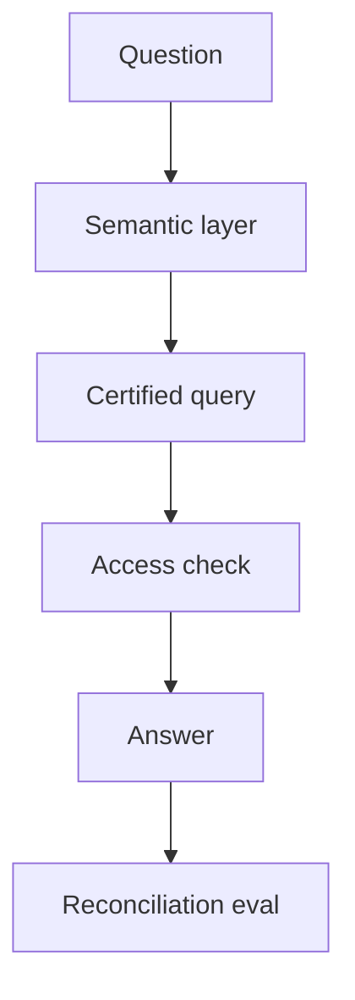

# Model Swap Test

By [Kshitij D Gupta](https://github.com/kshitijdgupta) ([LinkedIn](https://www.linkedin.com/in/kshitijdgupta)).

## What the test is

If you swapped the LLM behind your data agent tomorrow, would the answers stay correct?

They stay correct when four contracts live in the data layer. The model can change. The contracts stay: meaning, grain and freshness, access, and reconciliation. Hold those four, and a model swap leaves the answers on the same numbers.

This repo is a small checker for those contracts. It is a companion to [The Model Is Interchangeable. Your Data Layer Is Not](https://kshitijdgupta.substack.com/p/the-model-is-interchangeable-your). The numbers in `examples/` are synthetic.

A contract passes only when every metric in the file satisfies it. One gap fails that contract. The overall score is the number of passing contracts divided by four. The run passes only when the score is 1.00.

## The four contracts

### 1. Meaning lives in a semantic layer

Put the official definition in a metric record: name, owner, formula, and certified source. Aliases list other words for that same meaning. When two entries share a name, set a different `meaning` on each one, such as `finance` or `sales`.

```yaml
name: revenue
meaning: finance
owner: finance-analytics
formula: "sum(recognized_amount) where recognition_status = 'posted'"
certified_source: finance.mart.recognized_revenue
aliases:
  - recognized_revenue
```

The meaning contract fails when any metric is missing an owner, a formula, or a certified source. It also fails when two entries share a name and their meaning labels are missing or identical.

### 2. Grain and freshness are explicit

Say what one row represents, which clock the time window uses, and the as of time for the number. `fiscal` and `calendar` are the usual clocks. Any other clock is fine when it is written down.

```yaml
grain: one row per posted recognition event
clock: fiscal
freshness:
  as_of: previous_business_day
  max_lag: "1d"
```

`freshness` can be a string, or a mapping with `as_of`. `max_lag` is optional. The grain contract fails when grain is missing, clock is missing, or freshness is missing.

### 3. Access is inherited from the asking user

The agent can return a row only when the asking user can see that row. Record that rule on the metric.

```yaml
access:
  inherit_from: asking_user
```

`access: asking_user` is the same rule. The access contract fails when the policy is missing, or when `inherit_from` is any other value.

### 4. Eval is reconciliation

Keep a golden question, the certified value, and a tolerance. Compare the agent answer to that value. The tolerance is an absolute gap in the same units as the certified value. A gap equal to the tolerance passes. `0` means an exact match.

```yaml
reconciliation:
  question: Recognized revenue for fiscal year 2026
  certified_value: 1842000
  tolerance: 1
```

You can list more than one test. The reconciliation contract fails when a metric has no test, when a certified value or tolerance is missing or not a finite number, or when tolerance is negative.

## From question to checked answer



The semantic layer selects the metric, including the meaning label when the name is shared. The certified query applies that formula, grain, clock, and freshness. The access check limits the rows to what the asking user can see. Reconciliation compares the answer to the certified value.

## Quickstart

Python 3.10 or newer.

```bash
python -m pip install -e ".[dev]"
model-swap-test check examples/good_metrics.yaml
model-swap-test check examples/bad_metrics.yaml
```

If the console script is not on your path:

```bash
python -m model_swap_test check examples/good_metrics.yaml
```

Exit codes: `0` when all four contracts pass, `1` when any contract fails, `2` when the file is missing or is not a metric list.

`examples/good_metrics.yaml` scores 1.00:

```text
Model Swap Test: PASS
File: examples/good_metrics.yaml
Metrics checked: 3

Meaning: PASS

Grain and freshness: PASS

Access: PASS

Reconciliation: PASS

Contracts passed: 4/4
Overall score: 1.00
```

`examples/bad_metrics.yaml` uses `revenue` for two definitions and leaves both unlabeled. It also drops an owner, a formula, a certified source, freshness, grain, clock, and a reconciliation test. One revenue entry has no access policy. `order_count` sets `inherit_from` to `warehouse_admin`. The report:

```text
Model Swap Test: FAIL
File: examples/bad_metrics.yaml
Metrics checked: 3

Meaning: FAIL (5 findings)
- revenue #1: ambiguous name "revenue" has a second meaning that is not labeled
- revenue #2: ambiguous name "revenue" has a second meaning that is not labeled
- revenue #2: missing owner
- order_count: missing formula
- order_count: missing certified source

Grain and freshness: FAIL (3 findings)
- revenue #1: missing freshness
- order_count: missing grain
- order_count: missing clock

Access: FAIL (2 findings)
- revenue #2: no access policy
- order_count: access is not inherited from the asking user

Reconciliation: FAIL (1 finding)
- order_count: no reconciliation test

Contracts passed: 0/4
Overall score: 0.00
```

Repeated names are numbered in file order. The same text is stored in `examples/sample_output_good.txt` and `examples/sample_output_bad.txt`.

## Check your own metrics

Write a YAML file with a top level `metrics` list. One item per definition.

```yaml
metrics:
  - name: revenue
    meaning: finance
    owner: finance-analytics
    formula: "sum(recognized_amount) where recognition_status = 'posted'"
    certified_source: finance.mart.recognized_revenue
    aliases:
      - recognized_revenue
    grain: one row per posted recognition event
    clock: fiscal
    freshness:
      as_of: previous_business_day
      max_lag: "1d"
    access:
      inherit_from: asking_user
    reconciliation:
      question: Recognized revenue for fiscal year 2026
      certified_value: 1842000
      tolerance: 1
```

- `name`: the word the agent will hear.
- `owner`: the team that owns the definition.
- `formula`: how the certified number is calculated.
- `certified_source`: the table, view, or metric that number comes from.
- `meaning`: which definition this is. Required when two entries share a name, and the labels have to differ.
- `aliases`: optional other words for this same meaning. A shared name still needs a distinct `meaning` on each entry.
- `grain`: what one row represents.
- `clock`: the time axis. `fiscal` and `calendar` are the usual choices.
- `freshness`: text, or a mapping with `as_of`.
- `access.inherit_from`: `asking_user`.
- `reconciliation`: a `certified_value` and a `tolerance`. Include the golden `question` so a failure has a name.

Run it:

```bash
model-swap-test check metrics.yaml
```

Read the four contract lines first. Each one says `PASS` or `FAIL`. Findings under a failure name the metric and the gap. Fix the YAML and run the checker again. The score moves when a whole contract goes from fail to pass. A file that fails only access scores 0.75.

Names are compared without case. `Revenue` and `revenue` are the same name.

## Reconciliation helper

The checker confirms that a test is declared. The helper compares one agent answer to the certified value.

```bash
model-swap-test reconcile 1842001 1842000 --tolerance 1
model-swap-test reconcile 1900000 1842000 --tolerance 0.01 --relative
```

`--relative` treats the tolerance as a fraction of the certified value. A certified value of 0 with a relative tolerance passes only when the agent value is also 0.

```text
Reconciliation: PASS
Agent value: 1842001
Certified value: 1842000
Mode: absolute
Tolerance: 1
Delta: 1
Limit: 1
```

From Python:

```python
from model_swap_test import reconcile

result = reconcile(1842001, 1842000, tolerance=1)
assert result.passed
```

`result.delta` is the absolute gap. `result.limit` is the gap that still passes.

## Tests

```bash
pytest
```

GitHub Actions runs that suite on Python 3.10 and 3.12.

## The essay

[The Model Is Interchangeable. Your Data Layer Is Not](https://kshitijdgupta.substack.com/p/the-model-is-interchangeable-your)

## License

MIT. Copyright 2026 Kshitij D Gupta.
